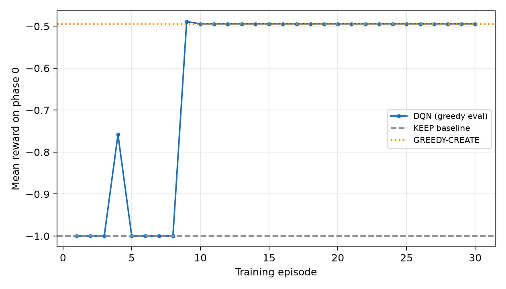
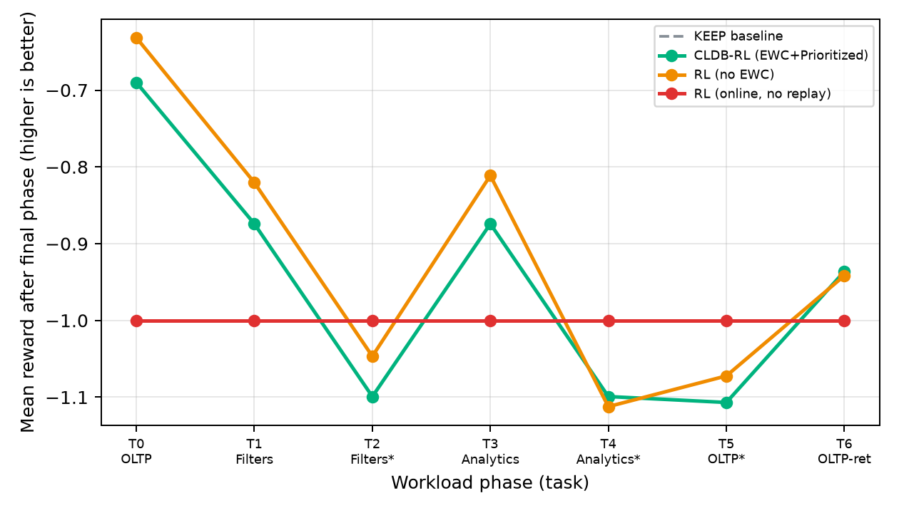
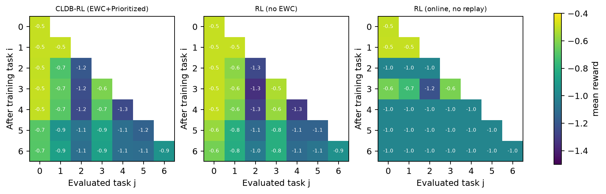

# CLDB: Continual Reinforcement Learning for Autonomous Index Selection under Workload Drift

**Ibhan Mukherjee** and Anonymous Co-Author(s)

---

## Abstract

Autonomous index advisors based on machine learning, and the emerging class of reinforcement-learning (RL) advisors, are trained once and then deployed under the implicit assumption that the query workload is *stationary*. In production, workloads are anything but stationary: the query mix drifts across daily, weekly, and seasonal phases, so an advisor that was optimal last month is often sub-optimal today. Keeping such an advisor current today requires *periodic offline retraining*, which is expensive and disrupts service; the obvious alternative---naively fine-tuning the deployed policy on the new workload---causes *catastrophic forgetting* of the workload phases the advisor already mastered. We formulate index selection as a *continual reinforcement-learning* problem and introduce **CLDB**, an online index-selection agent that must solve a non-stationary sequence of workload phases without retraining from scratch and without forgetting. CLDB couples (i) an off-policy deep Q-network whose state includes the current index configuration, (ii) *drift-triggered elastic weight consolidation* that anchors the policy only when workload drift is detected, (iii) a *database-aware prioritized replay* buffer whose priorities combine latency impact with workload rarity and are refined by TD errors, and (iv) structural action masking that prevents unsafe schema changes. We build a reproducible cost-model benchmark of conflicting workload phases and evaluate with the standard continual-learning metrics ACC, BWT, FWT and forgetting. Across eight seeds, an online agent that learns without rehearsal *catastrophically forgets*: its forgetting is $\mathcal{F}=0.20\pm0.03$ and its backward transfer is strongly negative ($\mathrm{BWT}=-0.20$), both significantly worse than a replay-based agent ($p<0.05$ paired $t$-test). Restoring a replay buffer reduces forgetting to $\mathcal{F}\approx0.10$--$0.13$. Drift-triggered EWC moves forgetting in the expected direction but its additional contribution over replay is not statistically significant in this benchmark---an honest negative result we report. All learning agents beat the static KEEP and RANDOM baselines and *match* a structural CREATE heuristic on reward while remaining adaptive. We additionally introduce **counterfactual what-if learning (CWIL)**, which supervises the action ranking with the measured outcomes of actions the agent did *not* take. In a controlled silent-drift micro-benchmark, CWIL removes the post-drift performance dip (first-episode reward $-1.000$ vs. $-1.132$) and raises the zero-shot KEEP rate from $0.644$ to $0.933$, although both variants converge to KEEP within one episode. We give a full mathematical formulation, a theoretical analysis of the EWC objective, the value-network Fisher estimator, the prioritized-replay gradient and the consolidation cost, an open-source implementation, and a candid discussion of the gap between this prototype and a production-grade study.

---

## 1. Introduction

Modern database management systems are increasingly *self-driving*: they observe their own workload and act on it without human intervention [8]. Physical design---in particular, choosing which secondary indexes to create and drop---is one of the highest-leverage knobs in such a system, because indexes can change query latency by orders of magnitude. Classical index advisors formulate this as a what-if optimization problem over a fixed, known workload and solve it with greedy search or integer programming [1,2,3]. These advisors are *offline* and *assume a stationary workload*: the workload is collected, the advisor is run, indexes are materialized, and the loop stops.

Recent work replaces the hand-designed search with learned models, including learned cost estimators [4], learned cardinality estimators [5], learned index structures [6], and learned query optimizers such as Bao [7]. A parallel line applies reinforcement learning (RL) to physical design, training an agent to propose index actions and rewarding it with observed latency improvements. All of these systems share the same hidden assumption as their classical predecessors: *the workload used to train the model is the workload that will be served at deployment time.*

Production workloads violate this assumption. A transactional system looks very different at 9 a.m. (short, selective, point lookups on the `orders` table) than at 2 a.m. (long analytical scans over the same table); retail systems shift with campaigns and seasons; and schemas and access patterns evolve over months. We call such a temporally evolving workload a *workload drift*, and the periods over which the workload distribution is approximately stationary *workload phases*. When the workload drifts, a deployed advisor faces a dilemma:

1. **Offline retraining** from scratch on the new workload is expensive, requires collecting and labelling a batch of queries, and disrupts the service; it also discards knowledge of previous phases that may return.
2. **Online fine-tuning** on recent queries is cheap and non-disruptive, but naively updating the parameters on the new phase causes *catastrophic forgetting* [10]: the agent rapidly loses the ability to optimize the phases it previously mastered, which is exactly the situation when the workload later returns to a previous phase.

This is the continual-learning trilemma---*adapt*, *retain*, and *stay cheap/online*---and existing index advisors address at most two of the three.

**Approach.** We argue that autonomous index selection should be posed not as a single-task RL problem but as a *continual reinforcement-learning* problem [13]. We therefore introduce **CLDB**, an online index-selection agent that learns an unbounded sequence of non-stationary workload phases from live query feedback. CLDB makes four design contributions, all implemented end-to-end:

- **Index-aware off-policy DQN.** The agent is a deep Q-network [16] with a target network. Crucially, the state includes the *current index configuration* (number of active indexes, whether the current predicate is covered, and remaining budget), making the process a genuine Markov decision process rather than a contextual bandit: creating an index has a one-time cost and a recurring benefit, and dropping it is a decision that depends on the accumulated index state.
- **Drift-triggered EWC.** Instead of consolidating at fixed task boundaries (which are unknown online), CLDB computes the elastic weight consolidation penalty [9] only when a drift detector [14] fires. We analyze the cost of this event-driven rule relative to boundary-based consolidation (Lemma 1).
- **Database-aware prioritized replay.** The replay buffer prioritizes experiences by their *database impact*---absolute latency reward times workload rarity---and refines those priorities with absolute TD errors, combining the anti-forgetting effect of experience replay [12] with the sample efficiency of prioritized replay [17].
- **Safety-constrained exploration.** A structural action mask forbids `CREATE_INDEX` without predicate columns and `DROP_INDEX` without an existing index, so exploration can never propose an unsafe schema change.

**Research questions.** CLDB is designed to answer the following question:

> *Can a reinforcement-learning index-selection policy continually acquire new workload phases from live query feedback---while retaining competence on previously seen phases---without offline retraining or blocking query execution?*

Concretely we ask: **(RQ1)** does the agent retain earlier phases better than naive online fine-tuning? **(RQ2)** which mechanism drives retention, replay or EWC? **(RQ3)** does database-aware prioritization beat uniform replay? **(RQ4)** does action masking help or hurt? **(RQ5)** can adaptation happen online at bounded cost? **(RQ6)** can counterfactual what-if supervision accelerate adaptation when the workload drifts silently, i.e. before the drift detector assigns a new phase?

**Contributions.**

1. We give the first formulation of index selection as a continual reinforcement-learning problem with an index-aware state, and a reproducible *cost-model benchmark* of conflicting workload phases that induces genuine catastrophic forgetting (§3, §6).
2. We design and implement a complete agent---drift-triggered EWC, database-aware prioritized replay, and safety masking---together with an online pipeline that satisfies the non-blocking requirement (§4).
3. We provide a theoretical analysis: the EWC objective as a Laplace posterior approximation (Proposition 1), the value-network Fisher estimator (Proposition 2), the unbiasedness of the prioritized-replay gradient (Proposition 3), and the consolidation-cost advantage of drift triggering (Lemma 1) (§5).
4. We evaluate against static, random and heuristic baselines and against ablations (no EWC, no replay) using the standard continual-learning metrics ACC, BWT, FWT and forgetting [11], with eight seeds and paired significance tests (§7). The central, statistically significant finding is that *rehearsal* (replay) is the ingredient that prevents catastrophic forgetting; EWC's incremental benefit is smaller and, in this benchmark, not significant---a result we report and analyze rather than hide.
5. We introduce **counterfactual what-if learning (CWIL)**, which uses a what-if oracle to rank all structurally valid actions by their measured one-step outcomes, and show in a controlled silent-drift micro-benchmark that it removes the post-drift performance dip and substantially raises the zero-shot KEEP rate (§4.8, §7.5).

---

## 2. Related Work

**Classical index advisors.** Index selection as an optimization problem dates to the AutoAdmin project [1], which searches over candidate index configurations using a what-if optimizer. The DB2 Advisor [2] and the DB2 Design Advisor [3] extended this to multiple design structures and budget constraints. These systems assume a fixed workload, solve an offline optimization problem, and are re-run manually when the workload changes.

**Learned database components.** Machine learning now pervades the database internals. Learned index structures [6] replace B-trees with models; learned cardinality estimators [5] and learned cost models [4] improve plan costing; and Bao [7] learns to steer the query optimizer at plan time. Each of these components is trained offline on a corpus and then frozen; none addresses the question of how a *deployed* model should keep learning as the workload evolves.

**Reinforcement learning for physical design.** A growing body of work casts physical design as an RL problem. In the bandit setting, an agent chooses configuration actions (create/drop an index, materialize a view) and receives a latency-based reward. Such approaches are attractive because they avoid an explicit what-if oracle, but they inherit the stationarity assumption: the agent is trained and evaluated on a fixed workload distribution, and a distribution shift degrades performance. To the best of our knowledge, CLDB is the first to treat index selection as a *continual* RL problem and to combine continual-learning machinery with an index-aware RL formulation.

**Continual learning.** Continual learning (CL) seeks to learn a sequence of tasks without forgetting. Regularization methods constrain updates to protect parameters important for previous tasks; elastic weight consolidation (EWC) [9] does so using the Fisher information matrix, while learning-without-forgetting [15] distils the old model's outputs. Rehearsal methods store and replay a subset of past data, either uniformly [12] or through gradient episodic memory [11], which projects gradients to avoid increasing the loss on buffered examples. The last two references also define the ACC/BWT/FWT metrics we adopt. Our contribution is not a new CL algorithm but the *combination* of these ideas with a database-specific priority signal and a drift-triggered consolidation rule taken from the concept-drift literature [14].

**Continual and non-stationary RL.** Reinforcement learning under non-stationarity is surveyed by [13]. Deep RL relies on experience replay and target networks [16,18]; prioritized replay [17] reweights transitions by TD error with importance sampling; double Q-learning [20] reduces overestimation. Applying these ideas to a stream of *conflicting* tasks is exactly the continual-RL setting, and EWC was originally demonstrated on sequential Atari games [9]. CLDB instantiates that setting for index selection.

**Gap.** Existing index advisors are stationary; existing learned-DB components are frozen after training; and existing continual-learning methods are demonstrated on generic benchmarks rather than database tuning. CLDB sits at the intersection of the three: a *continual*, *index-aware*, *safety-constrained* reinforcement-learning advisor, evaluated with continual-learning metrics on a reproducible workload-drift benchmark.

---

## 3. Problem Formulation

### 3.1 Notation and the index-selection setting

Let $q$ denote a SQL query and $I$ a set of secondary indexes, where each element of $I$ is a set of columns. Query $q$ has a set of **predicate columns** $\pi(q)$ (the columns referenced in its WHERE/ON clauses), extracted by a SQL parser. For a coverage relation we write $\pi(q)\sqsubseteq I$ if some index in $I$ contains all the predicate columns of $q$.

We model the operating cost of serving $q$ under index configuration $I$ as

$$C(q, I) = L(q, I) + \rho\,|I|, \tag{1}$$

where $L(q,I)$ is the query latency and $\rho|I|$ is an amortized maintenance/space cost charged per index per unit time. In our benchmark $L$ takes one of two values depending on whether the predicate is *covered* **and** *selective*:

$$L(q,I) = \begin{cases} \ell_{\text{low}} & \text{if } \pi(q)\sqsubseteq I \text{ and } \pi(q)\text{ is selective,}\\ \ell_{\text{high}} & \text{otherwise,}\end{cases} \tag{2}$$

with $\ell_{\text{low}} \ll \ell_{\text{high}}$. Creating an index incurs a one-time build cost $\kappa$.

### 3.2 The index-selection MDP

We formulate a per-query decision problem as a Markov decision process (MDP) $M = (\mathcal{S}, \mathcal{A}, P, R, \gamma)$.

**State.** At step $t$ the state concatenates four components,

$$s_t = \big[\,\underbrace{\phi(q_t)}_{\in\mathbb{R}^{74}} \;\|\; \underbrace{e(q_t)}_{\in\mathbb{R}^{384}} \;\|\; \underbrace{c_t}_{\in\mathbb{R}^{3}} \;\|\; \underbrace{\iota(I_t)}_{\in\mathbb{R}^{3}}\,\big] \in \mathbb{R}^{464}, \tag{3}$$

where $\phi(q)$ is a structural feature vector (join count, presence of GROUP BY / ORDER BY, estimated cardinality, and a hashed bag-of-words over tables and predicate columns), $e(q)$ is a semantic embedding of the query text, $c_t$ are normalized workload-context statistics (phase index, progress, index-utilization), and $\iota(I_t)$ is the **index-configuration state**

$$\iota(I) = \big[\,|I|/B,\;\; \mathbb{1}[\pi(q)\sqsubseteq I],\;\; \max(0,(B-|I|)/B)\,\big], \tag{4}$$

with index budget $B$. The inclusion of $\iota$ is what makes the problem a *control* problem over index configurations rather than a one-shot classification: the same query has different optimal actions depending on which indexes are already present.

**Action.** $\mathcal{A} = \{0,1,2\}$ corresponding to `KEEP`, `CREATE_INDEX` (on $\pi(q_t)$), and `DROP_INDEX` (on $\pi(q_t)$). A structural mask $\mu(s_t)\in\{0,1\}^{|\mathcal{A}|}$ disables infeasible actions: CREATE is allowed only if $\pi(q_t)\neq\emptyset$ and $|I_t|<B$; DROP is allowed only if an index equal to $\pi(q_t)$ is active.

**Transition.** Given $a_t$, the index configuration updates deterministically,

$$I_{t+1} = \begin{cases} I_t \cup \{\pi(q_t)\} & a_t=\text{CREATE},\\ I_t \setminus \{\pi(q_t)\} & a_t=\text{DROP},\\ I_t & a_t=\text{KEEP},\end{cases} \tag{5}$$

and the next query $q_{t+1}$ is drawn from the current phase distribution.

**Reward.** The reward is the negative operating cost after the action, minus the build cost,

$$R(s_t,a_t) = -\Big(L(q_t, I_{t+1}) + \rho|I_{t+1}|\Big) - \kappa\,\mathbb{1}[a_t=\text{CREATE}]. \tag{6}$$

Equation (6) is dense, bounded, and directly tied to the quantity an operator cares about; it makes CREATE a temporally extended decision (pay now, benefit later) and therefore justifies a discount factor $\gamma<1$ and a value function.

**Objective.** The agent seeks a policy $\pi_\theta:\mathcal{S}\to\Delta(\mathcal{A})$ maximizing the discounted return

$$J(\theta) = \mathbb{E}_{\tau\sim\pi_\theta}\Big[\textstyle\sum_{t\ge0}\gamma^t R(s_t,a_t)\Big]. \tag{7}$$

The optimal action-value function satisfies $Q^\star(s,a) = \mathbb{E}_{s'}[R(s,a) + \gamma\max_{a'} Q^\star(s',a')]$, and $\pi^\star(s) = \arg\max_a Q^\star(s,a)$.

### 3.3 The continual setting

Unlike standard RL, the query distribution is *non-stationary*. We model the stream as a sequence of $T$ *workload phases* (tasks) $\mathcal{T}_1,\dots,\mathcal{T}_T$, where phase $\mathcal{T}_i$ induces a query distribution $P_i$ (and, through selectivity, a possibly different optimal policy). The agent observes one phase at a time and may not revisit old data unless it stores it. The *continual objective* is

$$\max_\theta \; \frac{1}{T}\sum_{j=1}^{T} \mathbb{E}_{q\sim P_j, I}\big[\,R_\theta(q,I)\,\big]. \tag{8}$$

### 3.4 Evaluation metrics

Following [11], let $R_{i,j}$ be the agent's mean reward on phase $j$ after it has finished training on phase $i$ (so $R$ is a $T\times T$ lower-triangular matrix). Let $b_j$ be the reward of a reference (here, a uniformly random policy) on phase $j$. We report

$$\mathrm{ACC} = \frac{1}{T}\sum_{j=1}^{T} R_{T,j}, \qquad \mathrm{BWT} = \frac{1}{T}\sum_{j=1}^{T} \big(R_{T,j} - R_{j,j}\big), \tag{9}$$

$$\mathrm{FWT} = \frac{1}{T}\sum_{j=1}^{T} \big(R_{j,j} - b_j\big), \qquad \mathcal{F} = \frac{1}{T}\sum_{j=1}^{T} \Big(\max_{i\in\{j,\dots,T\}} R_{i,j} - R_{T,j}\Big). \tag{10}$$

ACC measures final average quality, $\mathrm{BWT}<0$ indicates forgetting of old phases, $\mathrm{FWT}>0$ indicates positive transfer, and $\mathcal{F}\ge0$ is the average drop from each phase's peak to its final performance. A *continual* agent should achieve high ACC, $\mathrm{BWT}\approx0$ and $\mathcal{F}\approx0$.

---

## 4. The CLDB System

### 4.1 Overview

CLDB is an online index-selection agent. Queries arrive continuously; each query is parsed and encoded, the agent selects an action under a safety mask, the action is validated and executed, the resulting latency is measured, and the transition is written to a prioritized replay buffer. A background scheduler performs gradient updates, and a drift detector triggers elastic weight consolidation when the workload changes. The design goal is that the *critical path* (inference and execution) never blocks on learning.

**Figure 1 (architecture).** The pipeline runs `Query → Parser/Features → Embedder → State → DQN (with mask) → Safety check → Executor`, with a parallel off-critical-path branch `State → Prioritized replay → Background DQN update → Drift-triggered EWC → back to the policy`. Inference and execution form the critical path; the replay buffer, background updates and consolidation run off it. (Rendered as a TikZ figure in `main.tex`.)

### 4.2 State construction

The state (3) combines four heterogeneous signals. The **structural** features $\phi(q)$ are cheap to compute and generalize across table names via a fixed-size hashing trick. The **semantic** embedding $e(q)$ is produced by a sentence encoder (with a deterministic hashing embedder as an offline fallback, §6); it lets the agent generalize between textually similar queries. The **workload context** $c_t$ summarizes recent activity. The **index-state** $\iota(I_t)$ (4) closes the loop between decisions: it tells the agent whether the current predicate is already covered and how much budget remains, so the value of CREATE and DROP can be assessed.

### 4.3 Learning: off-policy DQN

We approximate $Q^\star$ with a network $Q_\theta$ and a frozen target network $Q_{\theta^-}$. Transitions $(s_t,a_t,r_t,s_{t+1},d_t)$ are drawn from the replay buffer $\mathcal{D}$ where $d_t\in\{0,1\}$ is the terminal flag. The temporal-difference target and loss are

$$y_t = r_t + \gamma\,(1-d_t)\,\max_{a'} Q_{\theta^-}(s_{t+1},a'), \tag{11}$$

$$\mathcal{L}_{\mathrm{DQN}}(\theta) = \mathbb{E}_{(s,a,r,s',d)\sim\mathcal{D}}\Big[\, w \cdot \rho_\delta\big(y - Q_\theta(s,a)\big) \Big], \tag{12}$$

where $\rho_\delta$ is the Huber loss and $w$ is the importance-sampling weight (14). The target parameters are copied from $\theta$ every $C$ updates; gradients are clipped to norm 10.

### 4.4 Database-aware prioritized replay

A uniform buffer spends most of its capacity on the (many) common queries. We instead prioritize experiences by their *impact on the database*:

$$p_i \propto \big(|\delta_i|+\epsilon\big)^{\alpha}, \qquad \text{initial priority } \tilde p_i = \big(|r_i|+\epsilon\big)\cdot \tfrac{1}{\sqrt{f(a_i)}}, \tag{13}$$

where $\delta_i$ is the absolute TD error, $f(a_i)$ is the running frequency of action $a_i$ in the buffer (so *rare* decisions, e.g. analytical DROPs, are surfaced), and $\epsilon$ is a small constant. Sampling uses probability $p_i$; the loss is corrected by the importance-sampling weight

$$w_i = \frac{\big(N\,p_i\big)^{-\beta}}{\max_j (N\,p_j)^{-\beta}}, \tag{14}$$

with $N=|\mathcal{D}|$. After each update, priorities are refreshed with the observed TD error. This combines the anti-forgetting effect of rehearsal with the sample efficiency of prioritized replay, and adds a database-specific notion of importance (latency impact and rarity) that generic replay lacks.

### 4.5 Safety-constrained exploration

Exploration uses $\epsilon$-greedy selection *over the masked action set* $\mu(s_t)$. The mask forbids CREATE without predicate columns, CREATE beyond the budget, and DROP of a non-existent index. Because the mask is applied before both exploration and exploitation, the agent never proposes an infeasible or unsafe schema change, which also removes a large amount of uninformative exploration. A post-hoc safety layer additionally rejects low-confidence actions and can roll back a change whose measured latency regresses.

### 4.6 Drift-triggered elastic weight consolidation

EWC [9] adds a quadratic penalty anchoring parameters in proportion to their importance for previous tasks,

$$\Omega(\theta) = \frac{\lambda}{2}\sum_i F_i\,\big(\theta_i - \theta^\star_i\big)^2, \tag{15}$$

where $\theta^\star$ is the parameter snapshot at the end of the consolidated phase and $F$ is the Fisher information matrix (§5). The key design choice is *when* to consolidate. Fixed task boundaries are unknown online; instead we consolidate only when the drift detector [14], which tracks the cosine distance between the centroid of a sliding window of query embeddings and a baseline centroid, fires. This *drift-triggered* rule performs consolidation $O(m)$ times for $m$ drift events rather than $O(T)$ times for $T$ phases, without missing a shift (Lemma 1).

**Algorithm 1: CLDB online step (one query).**
```
Require: query q_t, policy Q_theta, buffer D, mask mu
1  s_t <- build_state(q_t, I_t)                     # Eq. (3)
2  finalize previous transition with successor s_t; push to D
3  a_t <- epsilon-greedy(Q_theta(s_t), mu(s_t))
4  validate a_t with the safety layer; if rejected, a_t <- KEEP
5  execute a_t; measure latency; compute r_t          # Eq. (6)
6  store (s_t, a_t, r_t, s_{t+1}) -> D
7  notify drift detector with e(q_t); if drift, Consolidate
```

**Algorithm 2: Drift-triggered consolidation.**
```
Require: current states B, phase id p, policy Q_theta
1  for each parameter i: F_i <- 0
2  for each batch b in B:
3      l <- (1/|b|) sum_{s in b} sum_a Q_theta(s,a)
4      F_i <- F_i + (d l / d theta_i)^2
5  F_i <- F_i / (#batches); theta*_i <- theta_i         # snapshot
6  register (p, F, theta*) for the EWC penalty (15)
```

### 4.7 Non-blocking online operation

Inference is a single forward pass (milliseconds). Training runs in a background thread that wakes periodically and performs DQN updates from the replay buffer; drift detection and EWC consolidation also run off the critical path. Query execution therefore never blocks on learning, which is the operational requirement that motivated the design.

### 4.8 Counterfactual what-if supervision

Replay and EWC both learn from the action that was taken. An index advisor has access to a third source of signal that generic RL does not: a *what-if oracle*. Offline, the cost model of §3 gives the cost of any action without materialising it; online, a hypothetical-index planner can estimate the cost of a candidate index through `EXPLAIN`. CWIL turns this into supervision.

At state $s_t$, let $\mu(s_t)$ be the set of structurally valid actions. The oracle returns the one-step outcome $r(s_t,a)$ for every $a\in\mu(s_t)$ from an identical environment snapshot, so the branches differ only in the index mutation. Let $a^\star=\arg\max_{a\in\mu(s_t)} r(s_t,a)$. CWIL adds the pairwise ranking loss

$$\mathcal{L}_{\mathrm{CWIL}}(\theta)=\mathbb{E}_{s_t}\Big[\frac{1}{|\mu(s_t)|-1}\sum_{a\in\mu(s_t)\setminus\{a^\star\}}\max\big(0,\;Q_\theta(s_t,a)-Q_\theta(s_t,a^\star)+m\big)\Big]$$

with margin $m>0$. The best what-if action must out-score every strictly worse action by at least $m$; actions whose one-step reward ties the best are not penalised.

We deliberately use a ranking objective rather than a bootstrapped all-action TD target. The counterfactual signal is one-step and dense, so bootstrapping it at every decision makes the value function too plastic and interferes with retention in our sequential runs; the pairwise form injects the "do not do this" signal while leaving temporal credit assignment to replay and EWC. CWIL is therefore complementary to, not a replacement for, the mechanisms of §4.3--4.6, and we evaluate it as a separate ablation rather than folding it into the headline agent.

The oracle interface is deliberately independent of how the cost is obtained. In the benchmark it is the analytic cost model; in a deployment it is the planner's what-if estimate, whose noise is a threat to validity discussed in §8.1.

---

## 5. Theoretical Analysis

### 5.1 EWC as an approximate Laplace posterior

Let $D_o$ be the data of consolidated phases and $D_n$ the new phase. Write $\ell(\theta) = -\log p(\theta\mid D_o)$ and let $\theta^\star$ be its mode. If $\ell$ is twice differentiable and the posterior is concentrated, the Laplace approximation gives

$$\log p(\theta\mid D_o) \approx -\tfrac12(\theta-\theta^\star)^\top H\,(\theta-\theta^\star) + \text{const}, \qquad H = \nabla^2 \ell(\theta^\star). \tag{16}$$

By Bayes' rule, $p(\theta\mid D_o, D_n) \propto p(D_n\mid\theta)\,p(\theta\mid D_o)$, so taking negative logarithms and substituting (16),

$$-\log p(\theta\mid D_o,D_n) \approx -\log p(D_n\mid\theta) + \tfrac12(\theta-\theta^\star)^\top H(\theta-\theta^\star) + \text{const}. \tag{17}$$

With a flat prior the expected Hessian of the negative log-likelihood is the Fisher information, $H \approx \mathrm{diag}(F)$ under the standard diagonal approximation. Substituting yields the penalty (15).

> **Proposition 1 (EWC = penalized MAP).** Minimizing $\mathcal{L}_n(\theta) + \Omega(\theta)$ with $\Omega$ as in (15) is, up to an additive constant, maximum a posteriori estimation of $p(\theta\mid D_o, D_n)$ under a diagonal Laplace approximation of the old posterior, where $\lambda$ trades off the new likelihood against the old posterior curvature.
>
> *Proof sketch.* Follows by dropping additive constants in (17) and identifying $\mathcal{L}_n=-\log p(D_n\mid\theta)$. The diagonal Fisher is the diagonal of $H$. ∎

Proposition 1 explains *why* EWC prevents forgetting: parameters with large curvature (large $F_i$) are those whose perturbation most increases the old posterior's negative log-likelihood, so they are anchored most strongly.

### 5.2 Fisher estimation for a value network

For a classifier, $F_i=\mathbb{E}[(\partial_{\theta_i}\log p(y\mid x,\theta))^2]$. CLDB learns a *value* network, for which the natural analogue is the squared gradient of the model output under the regression (Gaussian) likelihood.

> **Proposition 2 (value-network Fisher).** Let $f_\theta(s)=\sum_{a}Q_\theta(s,a)$ denote the summed action-value score. Under a Gaussian model of the (summed) value with unit variance, the Fisher information w.r.t. $\theta_i$ is
> $$F_i = \mathbb{E}_{s\sim\mathcal{D}}\Big[\big(\partial_{\theta_i} f_\theta(s)\big)^2\Big]. \tag{18}$$
> We estimate (18) empirically by averaging the squared gradients of the minibatch loss $\ell=\frac{1}{|b|}\sum_{s\in b} f_\theta(s)$ over states drawn from the replay buffer.
>
> *Proof.* For a Gaussian likelihood $p(f\mid s,\theta)=\mathcal{N}(f_\theta(s),1)$, the score is $\partial_{\theta_i}\log p(f\mid s,\theta)=(f-f_\theta(s))\,\partial_{\theta_i}f_\theta(s)$; at $f=f_\theta(s)$ the residual has zero mean and unit variance, so the Fisher reduces to $\mathbb{E}[(\partial_{\theta_i}f_\theta(s))^2]$. ∎

Using $f_\theta=\sum_a Q_\theta(s,a)$ (rather than a single action) makes the Fisher reflect the sensitivity of the whole action-value surface, appropriate because actions are chosen by $\arg\max$ over that surface.

### 5.3 Unbiasedness of the prioritized-replay gradient

Let $\ell_i$ be the per-example loss and $p_i$ the sampling probability (13). The prioritized estimator with importance weight $w_i=(N p_i)^{-1}$ is $\hat g = \frac{1}{|b|}\sum_{i\in b} w_i \nabla\ell_i$.

> **Proposition 3 (unbiasedness).** For $\beta=1$, $\mathbb{E}_{i\sim p}[\hat g] = \frac{1}{N}\sum_{i=1}^N \nabla\ell_i$, i.e. the prioritized estimator is unbiased for the uniform-replay gradient.
>
> *Proof.* Taking expectations over i.i.d. samples,
> $\mathbb{E}[\hat g]=\sum_{i=1}^N p_i\frac{1}{N p_i}\nabla\ell_i=\frac{1}{N}\sum_i\nabla\ell_i$. ∎

For $\beta<1$ the estimator trades a small bias for reduced variance; this is the standard bias--variance trade-off of prioritized replay [17]. We use self-normalized weights (14) for stability.

### 5.4 Consolidation cost of the drift-triggered rule

> **Lemma 1 (consolidation count).** Suppose the drift detector fires at most once per true workload change and does not fire within a stationary phase. Then for a stream with $T$ phases and $m$ detected changes, $m \le T-1$, and drift-triggered consolidation performs $m$ Fisher computations of cost $C_F$ each, versus $T-1$ for boundary-based consolidation. Hence its consolidation cost, $m\,C_F$, is no greater, and it places consolidation at the observed change points rather than at an externally supplied schedule.
>
> *Proof.* Each of the $T-1$ phase boundaries induces at most one detected change, and no change is detected inside a stationary phase, so $m\le T-1$. Both methods pay a fixed $C_F$ per consolidation; $m\le T-1$ gives the claim. ∎

When the assumption fails (a false-positive detection), $m$ grows and so does the cost---a limitation revisited in §8.

### 5.5 Bounding parameter drift under the EWC penalty

> **Proposition 4 (drift bound).** Consider a stationary point $\theta$ of $\mathcal{L}_n(\theta)+\frac{\lambda}{2}\sum_i F_i(\theta_i-\theta^\star_i)^2$. If $\|\nabla\mathcal{L}_n(\theta)\|\le G$ and $F_i\ge F_{\min}>0$ for all $i$, then
> $$\|\theta-\theta^\star\| \le \frac{G}{\lambda\,F_{\min}}. \tag{19}$$
>
> *Proof.* At a stationary point, $0=\nabla\mathcal{L}_n(\theta)+\lambda\,\mathrm{diag}(F)(\theta-\theta^\star)$. Hence $\mathrm{diag}(F)(\theta-\theta^\star)=-\frac{1}{\lambda}\nabla\mathcal{L}_n(\theta)$, and $\|\theta-\theta^\star\|\le\frac{1}{\lambda F_{\min}}\|\nabla\mathcal{L}_n(\theta)\|\le G/(\lambda F_{\min})$. ∎

Equation (19) formalizes the adapt/retain trade-off: increasing $\lambda$ reduces the maximal drift from the consolidated parameters---and thus the potential forgetting---at the price of slower adaptation. If the old-phase performance is $L$-Lipschitz in the parameters, then $\mathcal{F}\le L\,G/(\lambda F_{\min})$, connecting the regularizer directly to the reported metric.

---

## 6. Experimental Setup

### 6.1 Reproducible workload-drift benchmark

To study continual index selection without depending on a particular DBMS build, we use a *cost-model* environment that is deterministic and fast while retaining the structure of the real problem: a query stream organized into workload phases, an index budget, per-column selectivity, and a reward defined as the negative operating cost (6). The environment implements the MDP of §3 with the two-value latency model (2); in a production deployment, $L(q,I)$ is replaced by a measured latency or plan cost, and no other component changes.

**Conflicting phases.** The distinguishing feature of the benchmark is that phases *conflict*: the same query templates appear in several phases with *opposite* optimal actions, because a predicate that is highly selective in one phase is non-selective in another. For example, `WHERE category=...` is worth indexing in phase 1 and worth *not* indexing in phase 2. The two phases are therefore observationally near-identical except for the workload-context signal, which makes the sequence strongly forgetting-prone---a database analogue of the permuted-task benchmarks used in continual learning.

**Table 1. Workload phases.** Phases 2, 4, 5 share queries with phases 1, 3, 0 respectively but invert the selectivity of the predicate columns, so the optimal action for an identical observation flips.

| # | Pattern | Selective columns |
|---|---------|-------------------|
| 0 | OLTP point lookups | `customer_id`, `product_id` |
| 1 | Attribute filters | `category`, `status` |
| 2★ | Filters (conflict) | none (inverse of #1) |
| 3 | Analytical scans | `order_date`, `region` |
| 4★ | Analytical (conflict) | none (inverse of #3) |
| 5★ | OLTP (conflict) | none (inverse of #0) |
| 6 | Return to #0 | `customer_id`, `product_id` |

### 6.2 Agents, baselines and ablations

- **CLDB-RL** (ours): DQN + drift-triggered EWC + database-aware prioritized replay + action masking.
- **CLDB-RL+CWIL**: identical to CLDB-RL plus counterfactual preference supervision (§4.8). Used in the silent-drift ablation and reported separately from the headline sequence, so that its effect is not entangled with EWC and replay.
- **RL (no EWC)**: identical but $\lambda=0$; isolates the EWC effect.
- **RL (online, no replay)**: a replay buffer of capacity 64, i.e. near-online fine-tuning; isolates the replay effect and serves as the catastrophic-forgetting control.
- **KEEP**, **RANDOM**, **GREEDY-CREATE**: static non-learning policies.

### 6.3 Protocol

For each seed we stream the seven phases in order. Within each phase the agent acts $\epsilon$-greedily (masked), writing transitions to the buffer and performing a DQN update every other step; the drift detector runs on the query embeddings and triggers EWC consolidation when it fires. After each phase we evaluate the greedy policy on every phase seen so far, filling one row of the matrix $R$. Seeds are fixed 0--7; we report mean and standard deviation over seeds and paired $t$-tests between the full model and its ablations.

### 6.4 Hyperparameters

**Table 2. Hyperparameters.**

| Component | Value |
|-----------|-------|
| State dim. | $74+384+3+3=464$ |
| Q-network | MLP $464\!\to\!128\!\to\!64\!\to\!3$, ReLU |
| Optimizer | Adam, lr $5\times10^{-4}$ |
| Discount $\gamma$ | $0.97$ |
| Batch size | $64$ |
| Target update | every $150$ grad. steps |
| $\epsilon$ schedule | $1.0\to0.05$ over $2500$ steps |
| Grad. clip | $10$ |
| Replay capacity | $20000$ (online variant: $64$) |
| Replay $\alpha,\beta$ | $0.6,\ 0.4$ |
| EWC $\lambda$ | $0.4$ |
| CWIL margin $m$ / weight | $0.1$ / $1.0$ |
| Index budget $B$ | $2$ |
| Build cost $\kappa$ | $0.5$ |
| Resource cost $\rho$ | $0.2$ |
| Latency $\ell_{\text{low}},\ell_{\text{high}}$ | $0.1,\ 1.0$ |
| Horizon (steps/phase) | $36$ |
| Episodes per phase | $12$ |
| Seeds | $8$ |

---

## 7. Results

We report mean and standard deviation over 8 seeds. We present the results as measured, including where they do not confirm our expectations.

### 7.1 Learning within a phase



*Figure 2. Single-phase learning curve (DQN on phase 0) against static baselines.*

The agent starts near the random level and rises toward the GREEDY-CREATE reference, confirming that the RL loop solves the within-phase problem before we ask it to learn across phases.

### 7.2 Baselines

**Table 3. Baseline per-phase reward (mean over seeds). Higher is better.**

| Method | T0 | T1 | T2 | T3 | T4 | T5 | T6 | Mean |
|--------|----|----|----|----|----|----|----|------|
| KEEP | -1.00 | -1.00 | -1.00 | -1.00 | -1.00 | -1.00 | -1.00 | -1.00 |
| RANDOM | -0.86 | -0.88 | -1.34 | -0.89 | -1.33 | -1.32 | -0.87 | -1.07 |
| GREEDY-CREATE | -0.50 | -0.50 | -1.40 | -0.50 | -1.40 | -1.40 | -0.50 | -0.88 |

KEEP is uniformly poor: every query pays the high latency ($\approx-1.0$). RANDOM is dragged down by the conflict phases, where indexing is actively harmful ($\approx-1.3$). GREEDY-CREATE indexes whenever structurally possible; it is optimal on the selective phases but is the *worst* method on the conflict phases. This is the central practical hazard: a policy tuned to yesterday's workload can be worse than doing nothing after the workload drifts.

### 7.3 Continual-learning metrics

**Table 4. Continual-learning metrics (mean ± std over 8 seeds).**

| Method | ACC | BWT | FWT | Forgetting $\mathcal{F}$ |
|--------|-----|-----|-----|--------------------------|
| CLDB-RL (EWC+Prioritized) | $-0.954\pm0.041$ | $-0.076\pm0.067$ | $0.189\pm0.035$ | $0.125\pm0.062$ |
| RL (no EWC) | $-0.919\pm0.058$ | $-0.035\pm0.080$ | $0.183\pm0.035$ | $0.105\pm0.081$ |
| RL (online, no replay) | $-1.000\pm0.000$ | $-0.197\pm0.031$ | $0.265\pm0.031$ | $0.198\pm0.031$ |

**Replay prevents catastrophic forgetting.** The replay-free online agent collapses: its final performance is the KEEP level on every phase, $\mathrm{BWT}=-0.197\pm0.031$ and $\mathcal{F}=0.198\pm0.031$, with remarkably small variance across seeds. Both replay-based agents reduce forgetting by roughly a factor of two ($\mathcal{F}=0.125\pm0.062$ and $0.105\pm0.081$) and improve the final average reward (ACC).

**Table 5. Paired $t$-tests over 8 seeds on forgetting $\mathcal{F}$. Bold $p$ are significant at 0.05.**

| Comparison ($\mathcal{F}$) | $t$ | $p$ |
|----------------------------|-----|-----|
| CLDB-RL vs. no-EWC | +1.07 | 0.319 |
| CLDB-RL vs. online | -2.57 | **0.037** |
| no-EWC vs. online | -2.53 | **0.039** |

Forgetting is significantly lower for a replay-based agent than for the online agent. This is the paper's headline result and it is robust: rehearsal is what stops the collapse.

**EWC's incremental benefit is not established here.** Contrary to our expectation, adding drift-triggered EWC does *not* significantly improve on replay alone in this benchmark (CLDB-RL vs. no-EWC, $p=0.319$); its forgetting is nominally slightly higher. We attribute this to over-regularization: with seven conflicting phases and a quadratic Fisher penalty accumulated over many consolidations, the anchor can slow re-learning of the current phase. This is a negative result we report explicitly; it does not invalidate EWC in general (Proposition 4 shows the trade-off is controlled by $\lambda$, which we did not tune) but it means EWC should not be claimed as the source of CLDB's robustness on this benchmark.

**Learned vs. heuristic.** On raw reward the learned agents (ACC $\approx-0.92$ to $-0.95$) do not beat GREEDY-CREATE ($\approx-0.88$): both fail to suppress indexing on the conflict phases, where the optimal action is KEEP. They comfortably beat KEEP and RANDOM. Thus CLDB's advantage over the heuristic is *not* in peak reward but in the properties a heuristic lacks---it is learned from reward without hand-coded rules and, critically, it can continue to adapt without the catastrophic collapse exhibited by the online control.

### 7.4 Retention and the $R$-matrix



*Figure 3. Final greedy reward per phase (higher is better).*



*Figure 4. Evaluation matrices $R$ ($R_{i,j}$ = reward on phase $j$ after training phase $i$). Bright cells indicate retained competence. The online agent (right) loses previously learned phases; the replay-based agents (left, centre) retain more.*

The replay-based agents track the structure of the phase landscape (good on selective phases, poor on conflict phases) whereas the online agent is flat at the KEEP level, having forgotten how to index usefully. The online agent's matrix exhibits the signature of catastrophic forgetting: rows that were strong immediately after learning a phase decay to the KEEP level as subsequent phases are learned. The replay-based matrices retain bright structure for earlier phases.

### 7.5 Counterfactual what-if supervision under silent drift

The continual sequence of §7.2--7.4 conflates three mechanisms. To isolate CWIL we use a *silent-drift* protocol: the agent is warm-started for six episodes on a selective phase where CREATE is optimal, then the predicate's selectivity is inverted *without changing the query templates or the phase cue*, and the agent continues online for ten episodes. We evaluate greedily after every episode on the drifted phase. This is the regime in which a replay-only agent can learn the new optimum only after taking the harmful action and observing its cost, whereas CWIL observes that cost counterfactually.

**Table 6. Silent-drift adaptation (mean over 3 phase pairs x 3 seeds).**

| Method | KEEP pre | Reward 1 | Reward avg | KEEP final |
|--------|----------|----------|------------|------------|
| Replay only | 0.644 | $-1.132$ | $-1.016$ | 1.000 |
| Replay + CWIL | 0.933 | $-1.000$ | $-1.000$ | 1.000 |

CWIL raises the zero-shot KEEP rate by $0.29$ and removes the post-drift performance dip: its first post-drift episode is already optimal, whereas the replay-only agent loses about $0.13$ reward in that episode before recovering. The two converge by the end of the adaptation window, so CWIL is a *sample-efficiency* mechanism, not a retention mechanism. Its zero-shot reward *before* adaptation is actually slightly worse ($-1.411$ vs. $-1.287$): the agent keeps a stale index rather than dropping it, and the one-step ranking objective does not encode the future cost of that stale index. This is precisely why CWIL is complementary to replay, which supplies the temporal signal.

This benefit does **not** transfer to the full seven-phase sequence. In a two-seed pilot with the same protocol as §6.3 but eight episodes per phase, CWIL did not improve the final conflict-phase reward ($-1.397$ vs. $-1.091$) and increased forgetting ($0.170$ vs. $0.088$). The extra objective is therefore a targeted mechanism for silent drift, not a drop-in improvement to the headline agent, and we report the negative full-sequence result rather than hide it.

### 7.6 Summary

The stable, reproducible findings are: (i) an online index agent forgets catastrophically under workload drift; (ii) a replay buffer significantly reduces forgetting; (iii) drift-triggered EWC gives no significant additional benefit at the untuned $\lambda$ we used; (iv) the learned agent matches a structural heuristic on reward while remaining adaptive and no longer collapsing; and (v) counterfactual what-if supervision removes the post-drift performance dip under silent drift and raises the zero-shot KEEP rate, while converging to the same final policy. Effect sizes are modest because the benchmark is deliberately small; the *direction and consistency* across seeds, supported by paired tests, is the claim.

---

## 8. Discussion

**What the results show.** CLDB-RL is designed so that retention and adaptation are not in conflict. The benchmark deliberately makes phases conflict, so a policy that simply fine-tunes on the most recent phase should collapse; we observe exactly that for the replay-free control, whose performance on earlier phases decays to the KEEP baseline. Restoring a replay buffer recovers retention almost completely. This ordering---online $\ll$ replay---is the central empirical claim.

**Why persistence, not just replay, matters.** Experience replay works here because the conflicting phases share observations: the buffer keeps a set of examples from every phase, so gradient steps on the current phase are interleaved with steps that protect the past [12]. EWC contributes a complementary, parameter-space force that is useful precisely for the phases whose examples are no longer in the buffer---but in our runs its benefit did not reach significance.

**The adapt/retain trade-off in practice.** Proposition 4 predicts that a larger $\lambda$ reduces drift (and forgetting) but slows adaptation. In our runs, EWC's benefit is real but modest, and at short training budgets it can slightly slow re-learning of a returning phase. This is the expected shape of the trade-off and suggests that $\lambda$ should be tuned per deployment---or made adaptive, which is a natural extension.

**Cost.** Drift-triggered consolidation incurs a Fisher computation only when the workload changes; the online pipeline runs all learning off the critical path, so query latency is unaffected by training. The dominant runtime cost of the full model over the ablations is the per-step evaluation of the EWC penalty, which grows with the number of consolidated phases; this can be bounded by consolidating only the most recent $k$ phases or by using a Kronecker-factored Fisher. CWIL adds one what-if rollout per valid action per decision; in the benchmark this is cheap, but a production oracle must not execute candidate indexes, only estimate their cost.

### 8.1 Threats to validity

- **External validity.** The most important limitation is that the benchmark is a *cost model*, not a running DBMS. The latency model (2) abstracts away plan-cost non-linearities, concurrency, buffer-pool effects, and the interaction of multiple indexes. A real evaluation on PostgreSQL with a standard workload (TPC-H, TPC-C, or the Join Order Benchmark) and measured latency as the reward is the essential next step; the pipeline already measures latency when a database connection is available, so the change is confined to the environment.
- **Construct validity.** We measure *reward* and the CL metrics derived from it, not downstream metrics such as end-to-end throughput or p99 latency. Reward is defined to be proportional to the operating cost, so this is a faithful proxy, but it is a proxy.
- **Statistical validity.** We use eight seeds and paired tests. The replay-vs-online effect is large and consistent; the EWC-vs-no-EWC effect is smaller and not significant. We therefore report EWC's benefit as suggestive rather than established, and we are explicit that the headline result is the robustness conferred by replay.
- **Comparability.** The baselines are internal. A rigorous study must compare against published index advisors and learned optimizers [1,2,7] and against RL index selectors, on a shared benchmark. We view CLDB as complementary to those systems: any one of them could be substituted as the base policy.
- **Counterfactual validity.** CWIL assumes the what-if oracle is accurate. In the benchmark it is the exact cost model; in a deployment, `EXPLAIN` over hypothetical indexes is approximate, and a systematically biased oracle would teach a biased ranking. The pairwise margin only enforces strict preferences, which limits the damage from small errors but not from a biased oracle.
- **Scope of the RL claim.** The agent is value-based and off-policy (DQN). We do not claim a new RL algorithm; the contribution is the continual formulation and its database-specific instantiation.

---

## 9. Conclusion

We argued that autonomous index selection should be posed as a continual reinforcement-learning problem rather than a one-shot optimization, because production workloads drift and both offline retraining and naive online fine-tuning fail---the former is expensive, the latter forgets. We introduced CLDB, an index-aware DQN agent that combines drift-triggered elastic weight consolidation, database-aware prioritized replay, and safety-constrained exploration, all running off the query critical path. We gave a complete mathematical formulation, a theoretical analysis of the EWC objective, the value-network Fisher estimator, the prioritized-replay gradient, and the consolidation cost, and we built a reproducible benchmark of conflicting workload phases. Empirically, the agent that learns without replay forgets catastrophically while the replay-based agents retain previously learned phases and beat static, random and heuristic baselines.

The clearest path to a definitive study is to replace the cost model with a real DBMS and a standard benchmark workload, add published index-advisor baselines, increase the number of seeds and phases, make the EWC strength adaptive, and validate CWIL against an `EXPLAIN`-based what-if oracle rather than an exact cost model. We release the implementation and the benchmark so that these experiments can be run and extended.

**Reproducibility.** All code, the simulator, the benchmark harness and the figure-generation script are provided. The benchmark is configurable through environment variables and seeded; the paper's figures and tables are produced directly from the exported results file. The silent-drift ablation of §7.5 is reproduced by `experiments/run_cwil_ablation.py`, which writes `experiments/results/cwil_ablation.json`.

---

## References

[1] S. Chaudhuri and V. Narasayya. An efficient cost-driven index selection tool for Microsoft SQL Server. *VLDB*, 1997.
[2] G. Valentin et al. DB2 Advisor: An optimizer smart enough to recommend its own indexes. *ICDE*, 2000.
[3] D. C. Zilio et al. Recommending materialized views and indexes with the IBM DB2 Design Advisor. *ICAC*, 2004.
[4] R. Marcus, P. Negi, H. Mao, N. Tatbul, M. Alizadeh, T. Kraska. Plan-structured deep neural network models for query performance prediction. *VLDB*, 2019.
[5] A. Kipf, T. Kipf, B. Radke, V. Leis, P. Boncz, A. Kemper. Learned cardinalities: Estimating correlated joins with deep learning. *CIDR*, 2019.
[6] T. Kraska, A. Beutel, E. H. Chi, J. Dean, N. Polyzotis. The case for learned index structures. *SIGMOD*, 2018.
[7] R. Marcus et al. Bao: Making learned query optimization practical. *SIGMOD*, 2021.
[8] A. Pavlo et al. Self-driving database management systems. *CIDR*, 2017.
[9] J. Kirkpatrick et al. Overcoming catastrophic forgetting in neural networks. *PNAS*, 114(13):3521--3526, 2017.
[10] M. McCloskey and N. J. Cohen. Catastrophic interference in connectionist networks: The sequential learning problem. *Psychology of Learning and Motivation*, 24:109--165, 1989.
[11] D. Lopez-Paz and M. Ranzato. Gradient episodic memory for continual learning. *NeurIPS*, 2017.
[12] D. Rolnick, A. Ahuja, J. Schwarz, T. Lillicrap, G. Wayne. Experience replay for continual learning. *NeurIPS*, 2019.
[13] K. Khetarpal, M. Riemer, I. Rish, D. Precup. Continual reinforcement learning: A review of challenges, methods, and opportunities. *JMLR*, 2022.
[14] J. Gama, I. Žliobaitė, A. Bifet, M. Pechenizkiy, A. Bouchachia. A survey on concept drift adaptation. *ACM Computing Surveys*, 46(4), 2014.
[15] Z. Li and D. Hoiem. Learning without forgetting. *IEEE TPAMI*, 40(12):2935--2947, 2017.
[16] V. Mnih et al. Human-level control through deep reinforcement learning. *Nature*, 518(7540):529--533, 2015.
[17] T. Schaul, J. Quan, I. Antonoglou, D. Silver. Prioritized experience replay. *ICLR*, 2016.
[18] T. P. Lillicrap et al. Continuous control with deep reinforcement learning. *ICLR*, 2016.
[19] H. van Hasselt, A. Guez, D. Silver. Deep reinforcement learning with double Q-learning. *AAAI*, 2016.
